# Nexis Lens: Design Document

A gesture-augmented viewer for presenting code, git diffs and markdown. Keyboard and mouse do everything; hand gestures are an optional layer for presenting from across the room.

> Mock-ups are rendered from [`design-document.html`](design-document.html) (the HTML source) into [`design/mockups/`](design/mockups). Gesture drawings are generated by [`design/gestures.py`](design/gestures.py).

**Contents:** [1 Title](#nexis-lens-design-document) · [2 Tasks](#2-tasks) · [3 Prototypes](#3-prototypes) · [3.8 Gesture design](#38-gesture-design) · [4 Non-interface components](#4-non-interface-components) · [References](#references)

---

## 2. Tasks

1. **Open a workspace:** choose a local folder (or reopen a recent one) so its files and git state appear in the sidebar.
2. **Browse and read files:** select files in the tree, scroll, search with Ctrl+F, and switch markdown between Raw and Preview.
3. **Review a git diff:** view working-tree changes or a past commit, step through hunks, and choose a unified or split layout.
4. **Switch tabs and use the session overview:** move between open items, or jump to any of them from a grid.
5. **Zoom and present:** scale content for a room and enter presentation mode with the interface hidden.
6. **Control the viewer with gestures:** turn on the camera, arm gestures, then scroll, zoom and flip modes on the focused file, and leave it for File mode to pick another file.
7. **Benchmark tracking in the Gesture lab:** run a 10 second test of frame rate, latency and detection rate, then copy the results.

---

## 3. Prototypes

High-fidelity mock-ups drawn to match the running app (dark theme). Multi-step tasks are storyboards: read the frames top to bottom. Each is explained with Shneiderman's Eight Golden Rules.

### 3.1 Open a workspace

Storyboard: 1a Welcome → 1b Pick folder → 1c Workspace loaded (or 1d Error).

| | |
|---|---|
| **1a.** Welcome screen (every launch starts here) 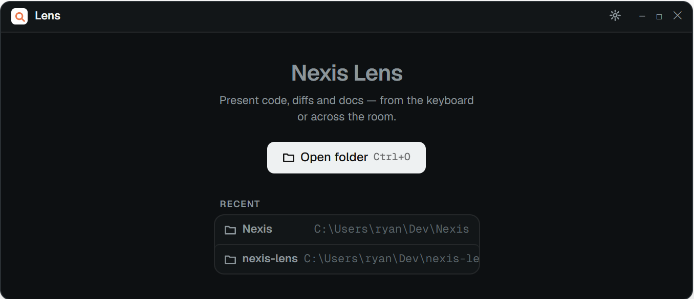 | **1b.** Native folder picker 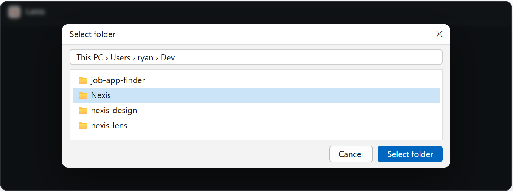 |
| **1c.** Workspace loaded, nothing open yet 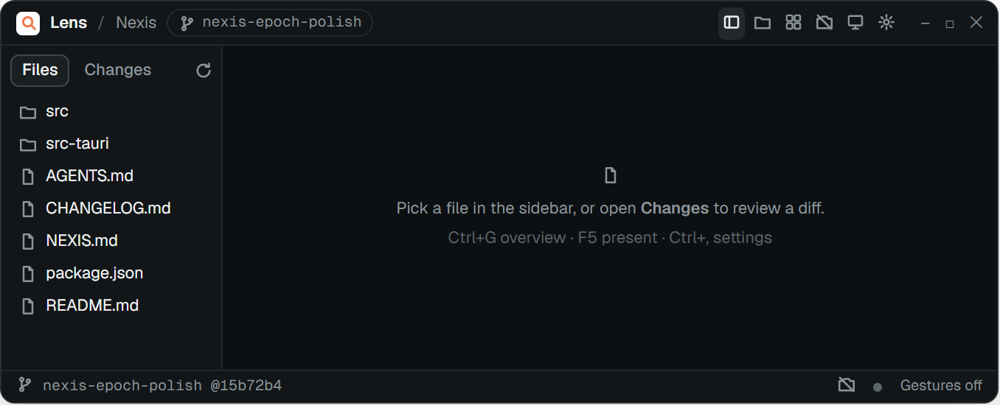 | **1d.** Error: the folder could not be opened 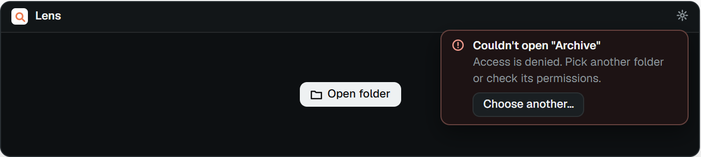 |

**Eight Golden Rules**
1. **Consistency:** the one primary action (Open folder) uses the filled button style used for primary actions everywhere.
2. **Shortcuts:** Ctrl+O opens the picker from anywhere; a recent workspace reopens in one click.
3. **Feedback:** once loaded, the title bar shows the workspace name and branch, and the status bar shows branch and commit.
4. **Closure:** the flow ends in a loaded workspace whose empty stage says what to do next.
5. **Error handling:** a failed open names the folder and the cause and offers "Choose another…".
6. **Reversal:** Cancel in the picker changes nothing; opening another folder is always one shortcut away.
7. **User control:** the user picks the folder; the app never scans the disk on its own.
8. **Memory load:** recents show name and full path, so users recognise rather than retype.

### 3.2 Browse files and read code or markdown

Storyboard: 2a Markdown in Preview → 2b Code with find.

**2a.** Markdown file in Preview mode
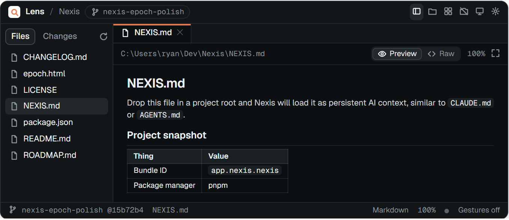

**2b.** Code file with Ctrl+F find (match 3 of 12)
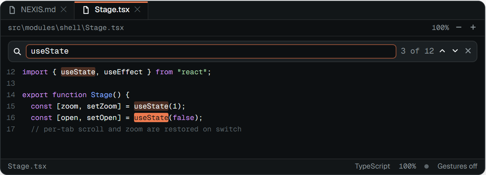

**Eight Golden Rules**
1. **Consistency:** every file type shares the same tab bar, path bar and status bar; only the content area changes.
2. **Shortcuts:** Ctrl+F to find, Ctrl+Shift+V for Preview/Raw, Ctrl+= / Ctrl+− to zoom.
3. **Feedback:** the open file is highlighted in the tree and underlined in orange in the tab bar; find shows "3 of 12".
4. **Closure:** the Preview/Raw toggle shows the active mode the moment it changes.
5. **Error handling:** binary or unreadable files show a message in place of the content, not a blank pane.
6. **Reversal:** Esc closes find; the toggle flips back; closing a tab never touches the file.
7. **User control:** the viewer is read-only and never navigates on its own.
8. **Memory load:** the full path stays visible above the content, and per-tab scroll and zoom are restored.

### 3.3 Review a git diff

Storyboard: 3a Working-tree change in split layout → 3b Past commit in unified layout. Both live in the Changes tab; history sits under the working tree.

**3a.** Changes tab: working tree, split diff, hunk 2 of 5
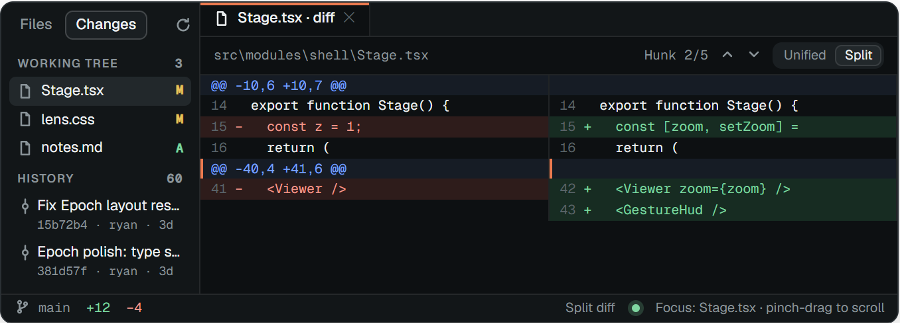

**3b.** A past commit from History, unified layout
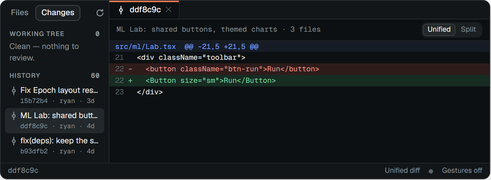

**Eight Golden Rules**
1. **Consistency:** added lines are green with "+", removed lines red with "−", in both layouts (never colour alone).
2. **Shortcuts:** `]` and `[` step through hunks; Ctrl+Shift+U switches unified/split.
3. **Feedback:** "Hunk 2/5", an orange marker on the current hunk, and +/− totals in the status bar.
4. **Closure:** stepping past the last hunk should say so instead of silently stopping (proposed; not built yet).
5. **Error handling:** a clean tree says "Clean — nothing to review"; a folder that isn't a repo says so.
6. **Reversal:** the view is read-only, so nothing here can damage the repo; the layout toggle flips back.
7. **User control:** the user chooses the file, the commit and the layout.
8. **Memory load:** the status bar names the layout and, when gestures are on, what the hand currently controls.

### 3.4 Switch tabs and use the session overview

Storyboard: 4a several tabs open → 4b Ctrl+G overview → Enter returns to the chosen tab.

**4a.** Tab bar with four open items (Ctrl+Tab cycles)
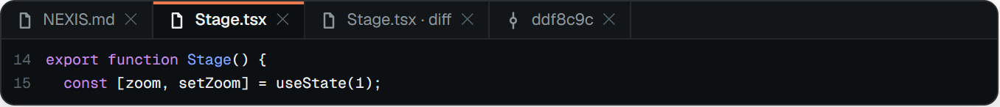

**4b.** Session overview: arrows move, Enter opens, Esc closes
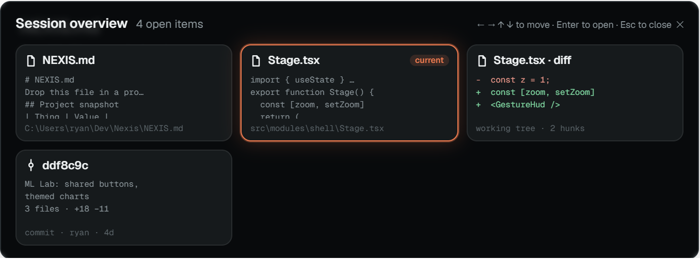

**Eight Golden Rules**
1. **Consistency:** the orange accent marks "current" in both the tab bar and the overview.
2. **Shortcuts:** Ctrl+Tab / Ctrl+Shift+Tab, Ctrl+G, arrow keys and Enter.
3. **Feedback:** the glowing card follows focus and carries a "current" badge.
4. **Closure:** Enter closes the overview on the chosen tab.
5. **Error handling:** with nothing open, the overview says so rather than showing an empty grid.
6. **Reversal:** Esc returns to the tab you came from.
7. **User control:** the overview opens only when asked for.
8. **Memory load:** each card previews its content and path, so tabs are recognised, not recalled.

### 3.5 Zoom and present

Storyboard: 5a zoom for the room → 5b F5 presentation mode.

**5a.** Zoomed to 150% (Ctrl+=)
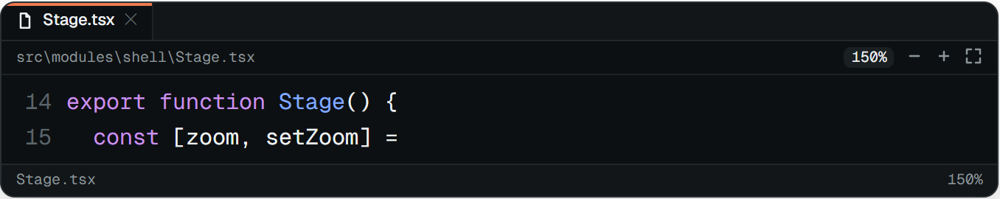

**5b.** Presentation mode (F5): no title bar, sidebar or status bar (exit hint is proposed, not built yet)
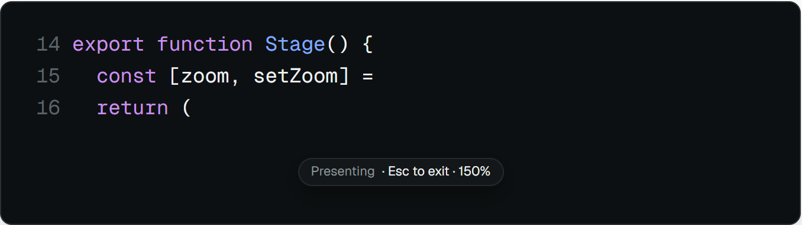

**Eight Golden Rules**
1. **Consistency:** the same zoom keys and the same zoom gesture work in code, markdown and diffs.
2. **Shortcuts:** F5, Ctrl+= / Ctrl+− / Ctrl+0, Ctrl+9 to fit.
3. **Feedback:** the zoom level appears next to the content and in the status bar.
4. **Closure:** entering and leaving presentation mode is one explicit action.
5. **Error handling:** zoom is clamped to a minimum and maximum so text never vanishes.
6. **Reversal:** Esc leaves presentation mode; Ctrl+0 resets zoom.
7. **User control:** nothing enters presentation mode on its own.
8. **Memory load:** a small "Esc to exit" hint stays visible while presenting.

### 3.6 Control the viewer with gestures

Storyboard: 6a Settings → Camera → 6b Settings → Gestures → 6c Focus mode on a file → 6d File mode → (close hand) → back to 6c on the new file.

**6a.** Settings → Camera: preview and tracking area
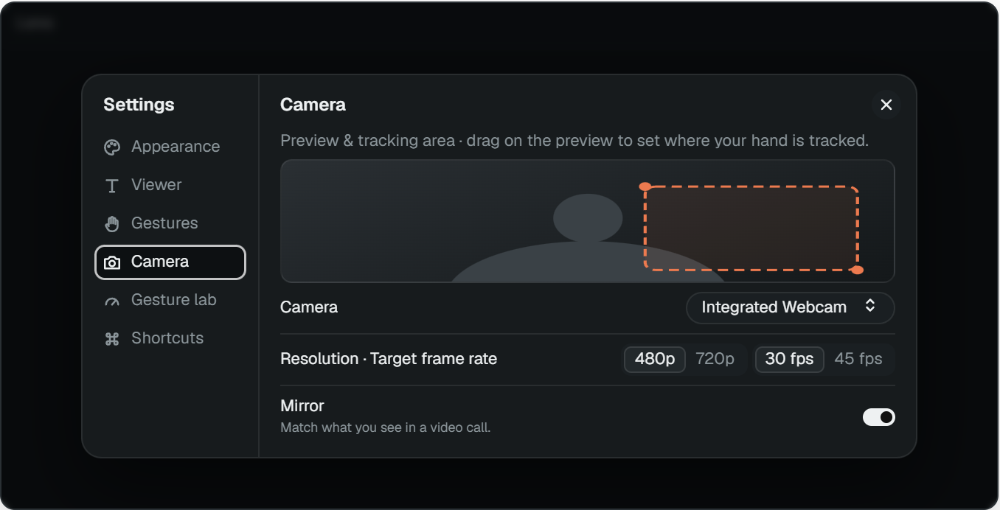

**6b.** Settings → Gestures: turn on, keep arming required, check the bindings
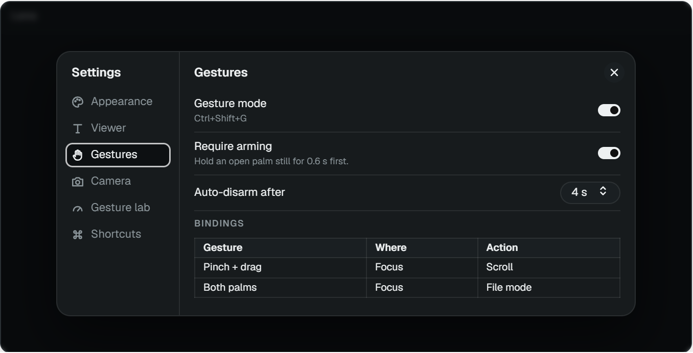

**6c.** Focus mode: gestures only act on the open file
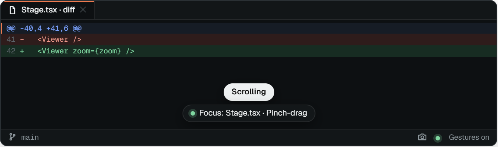

**6d.** File mode (after showing both palms): gestures only move through the file list
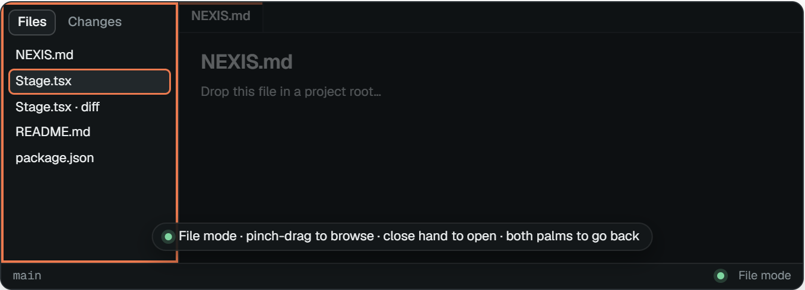

**Eight Golden Rules**
1. **Consistency:** pinch-and-drag means "move this" in both modes: it scrolls the file in Focus mode and the list in File mode.
2. **Shortcuts:** Ctrl+, opens Settings; Ctrl+Shift+G switches gestures on or off without opening it.
3. **Feedback:** the HUD always names the mode and what the hand controls ("Focus: Stage.tsx"); File mode outlines the sidebar in orange.
4. **Closure:** closing the hand on a file opens it and drops back into Focus mode, which the HUD confirms.
5. **Error handling:** the HUD reports "Camera error", "No hand in frame" or "Low confidence" instead of guessing.
6. **Reversal:** showing both palms again in File mode cancels and returns to the file you left.
7. **User control:** gestures are opt-in and need a deliberate arm step; while a file is focused, no gesture can change files.
8. **Memory load:** only two modes, and File mode spells out its three gestures on screen.

### 3.7 Benchmark tracking in the Gesture lab

Storyboard: start the camera → run the 10 s benchmark → read the verdict and copy it as Markdown.

**7.** Settings → Gesture lab after a run (numbers from the first real run, below)
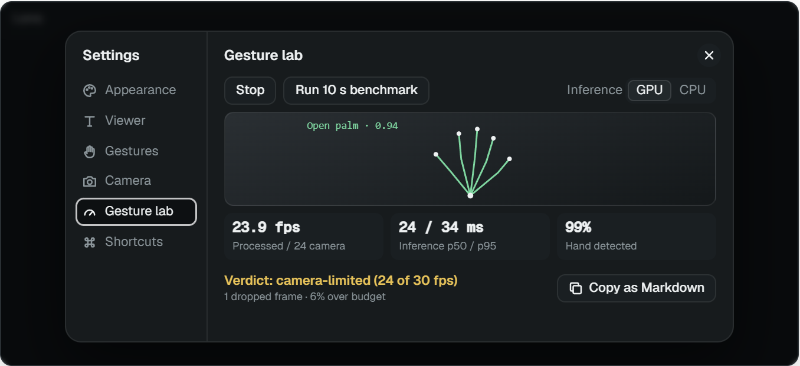

**Eight Golden Rules**
1. **Consistency:** one more page in the same Settings window, with the same controls.
2. **Shortcuts:** Ctrl+, then one click; one button copies the whole result.
3. **Feedback:** live skeleton overlay, the recognised gesture with its confidence, and metrics during the run.
4. **Closure:** after 10 s a verdict line states whether the target was met.
5. **Error handling:** "Camera off" and a disabled Run button prevent a run with no camera.
6. **Reversal:** Stop ends the camera at any time; a run can be repeated.
7. **User control:** the user starts the camera and the run, and picks GPU or CPU inference.
8. **Memory load:** "Copy as Markdown" replaces writing numbers down.

---

## 3.8 Gesture design

### The demo, and what it needs

The demo uses three items: a markdown file, a code file and a git diff. Each needs only a few controls:

| Item | Needs |
|---|---|
| Markdown | Scroll, zoom, switch Raw ↔ Preview |
| Code | Scroll, zoom |
| Git diff | Scroll, zoom |
| Moving between them | Leave the file, pick another, open it |

So the vocabulary can be small. A small set is easier to learn and gives the recogniser fewer poses to confuse.

### The model: two locked modes

Gestures are **locked to one target at a time**, so a gesture can only ever do something that makes sense for what is on screen.

- **Focus mode:** the open file has the gestures. Hands can scroll, zoom and (in markdown) flip modes. No gesture can switch files, so a stray swipe while presenting cannot jump away.
- **File mode:** the file list has the gestures. Hands can move the highlight and open a file. Nothing scrolls or zooms the content.

A two-hand gesture is the only way between them, because two hands almost never happen by accident.

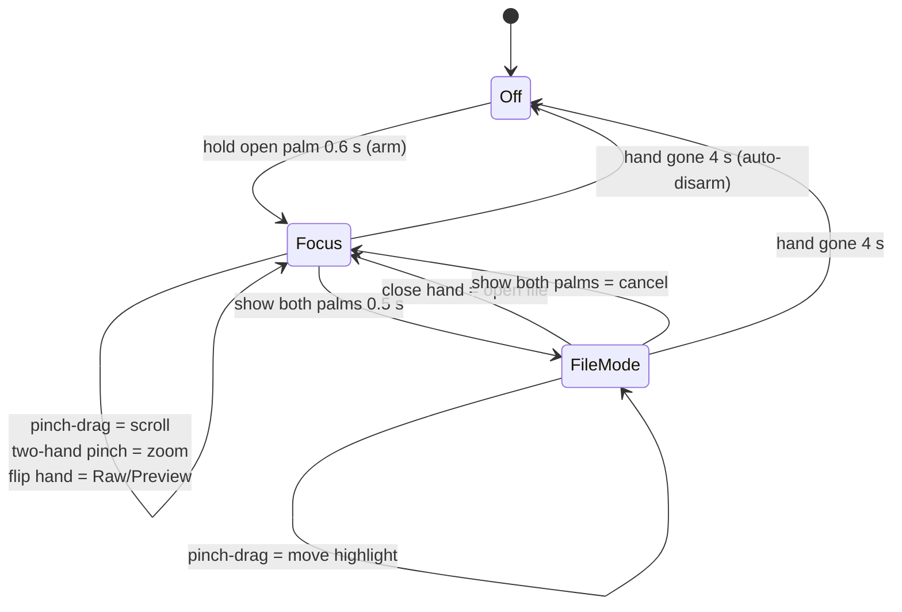

### The proposed gesture set

| | Gesture | Mode | Does | Keys |
|---|---|---|---|---|
| 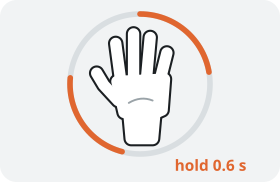 | **Hold an open palm** for 0.6 s | Off → Focus | Arms gestures | Ctrl+Shift+G |
| 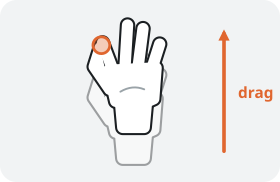 | **Pinch and drag** up or down | Focus | Scrolls the file, like dragging paper | wheel, arrows |
| 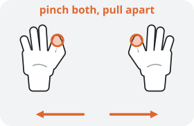 | **Pinch with both hands, pull apart / push together** | Focus | Zooms in / out | Ctrl+= / Ctrl+− |
| 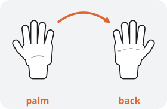 | **Turn the hand over** (palm → back) | Focus, markdown only | Raw ↔ Preview | Ctrl+Shift+V |
| 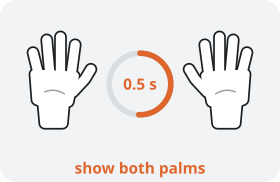 | **Show both open palms** for 0.5 s | Focus → File mode, or cancel | Leaves the file / goes back | Ctrl+G (overview) |
| 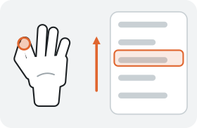 | **Pinch and drag** up or down | File mode | Moves the highlight through the files | arrows |
| 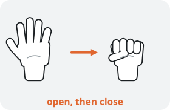 | **Open hand, then close it** (grab) | File mode → Focus | Opens the highlighted file | Enter |

### Why these gestures

- **Pinch-and-drag to scroll, not an open palm.** An open palm is how hands rest and wave while someone talks, so scrolling on any moving palm fires constantly. This is the Midas touch problem [1]. A pinch is deliberate: nothing moves until thumb and index touch, and letting go stops it, like a clutch. Apple's visionOS uses the same pinch-and-drag for scrolling [6], so many people will already know it. (Our first benchmark shows the risk: 4 frames of palm movement were picked up in a 10 s run in which nobody meant to scroll.)
- **Two-hand pinch to zoom.** "Spread to enlarge" is one of the most agreed-upon gestures in user-defined gesture studies [4]. A one-hand pinch can't zoom here because one-hand pinch now scrolls. A webcam also cannot measure depth well, so "push toward the screen" is not an option.
- **Turn the hand over for Raw / Preview.** Flipping matches the idea of seeing the other side of the same page. It only works in markdown, the only item with two modes, so it can't collide with anything else. It still has no study behind it, so it is the first candidate for the guessability test.
- **Both palms to leave a file.** Showing both open palms is the common "stop / hands off" sign. It needs two hands and a 0.5 s hold, which makes accidents very unlikely, and the hold separates it from two-hand zoom (which is pinched, not open). Surale et al. compared eleven bare-hand mode-switching techniques [7]; using the non-dominant hand to switch modes is one of the options they tested. We have not checked their results in detail.
- **Grab (close the hand) to open.** Closing the hand reads as "take this one". It is a distinct pose that MediaPipe already detects reliably (the fist classifier exists). Point-and-dwell selection is more accurate but users preferred an active gesture in one study [8]; grab is an active gesture.
- **Swipes are dropped from the demo.** Swipes were the main way to change tabs, which is exactly what Focus mode forbids. Fast flicks also misfire on the return stroke. Hunk stepping in the diff stays on `]` and `[`.
- **Keep the arming step.** Arming separates "I'm presenting with my hands" from "I'm just talking". Auto-disarm after 4 s with no hand keeps it safe if the presenter walks away.

### How each gesture is recognised

MediaPipe returns 21 landmarks per hand. `recognizer.ts` sorts each frame into one of five poses (open, fist, point, pinch, other) from finger geometry, then turns pose plus motion into events. Distances are divided by palm size (wrist to middle knuckle), so thresholds hold near or far from the camera.

| Gesture | Detected when | Status in code |
|---|---|---|
| Open palm (pose) | At least 4 fingers extended (tip more than 1.15× further from the wrist than its middle joint) | Exists |
| Arm | Open palm moving under 0.18 frame-widths/s for 600 ms | Exists |
| Pinch (pose) | Thumb–index gap under 0.28 palm sizes; released above 0.40 (the gap stops flicker) | Exists |
| Pinch-drag | While pinched, palm movement above a small dead zone becomes scroll | Built |
| Two-hand pinch zoom | Both hands pinched; the change in distance between the pinch points sets the zoom | Built |
| Flip | Open palm whose facing (sign of the palm normal from wrist and two knuckles) changes within 700 ms | Exists |
| Both palms | Two open hands, both nearly still, for 500 ms | Built |
| Grab | Open pose followed by fist within ~500 ms, held 140 ms | Built |
| Mode lock | Dispatcher only resolves bindings for the current mode | Built (`bindings.ts`, `picker.ts`) |

Only the highest-confidence hand drives one-hand gestures, so two hands never fire twice. The dispatcher adds a confidence floor, the arming gate, auto-disarm after 4 s and a 450 ms cooldown between discrete commands.

### First benchmark result

Gesture lab, 10 s run, GPU delegate, 640×480, macOS (WebKit).

| Metric | Result | Reading |
|---|---|---|
| Camera / processed | 24.0 / 23.9 fps | Below the 30 fps target, but the camera only delivered 24 fps and nearly every frame was processed. The webcam is the limit, not the model. |
| Inference mean / p50 / p95 / p99 / max | 23.5 / 24 / 34 / 43 / 49 ms | The median fits a 30 fps budget (33.3 ms); 6% of frames go over it. |
| Latency p50 / p95 | 39 / 60 ms | Well under the roughly 100 ms where a response stops feeling instant. |
| Hand detected | 99%, confidence 0.98 | Tracking quality is not a problem in these conditions. |
| Model load | 2853 ms | Noticeable; the "Starting camera…" state has to cover it. |
| Gestures | Point 50, Palm 4, Arm 2, Fist 1 | Different units: Point and Palm are counted per frame (50 frames ≈ 2.1 s of pointing); Arm and Fist once per gesture. |

**Next steps:** run again in better light or at 720p to see whether the camera reaches 30 fps (Mac webcams often drop frame rate in dim light); report continuous gestures in seconds in the lab; repeat on the Windows target laptop.

### How we will validate the gesture set

- **Guessability test** [4]: show 5 to 8 people each outcome ("scroll down", "zoom in", "show the raw markdown", "go to another file", "open this file") and record the gesture they try first. Keep a gesture if most people agree on it; flip is the most at risk.
- **Accidental-command count:** five minutes of normal presenting in Focus mode, counting any command nobody meant. The goal is zero file changes and very few stray scrolls.
- **Benchmark** each change in the Gesture lab, and add recorded-landmark tests for the new detectors (pinch-drag, two-hand pinch, both palms, grab).

---

## 4. Non-interface components

- **Shell and backend:** Tauri v2 app (Rust backend, React 19 + TypeScript front end). Typed IPC connects the two; a browser-only mode serves an in-memory demo workspace.
- **Files:** the Rust backend opens folders, lists files respecting .gitignore, and reads file contents on request.
- **Git:** the backend runs the git CLI for status, diff, log and show; the front end parses unified diffs for the unified and split views.
- **Command bus:** keyboard, toolbar and gestures all call `runCommand(id, args, source)`; the active view handles it. This is why every task works without a camera.
- **Gesture pipeline:** camera → MediaPipe HandLandmarker (WASM and model bundled under `public/mediapipe/`, no CDN, works offline) → recogniser (landmarks to poses to events) → dispatcher (confidence floor, arming, mode lock, auto-disarm, cooldown) → bindings → command bus.
- **Performance plan:** target at least 30 fps on an 8 GB integrated-GPU laptop. Profile in the Gesture lab; if short, drop to 480p, skip frames, or move inference to a worker with OffscreenCanvas.
- **Privacy and permissions:** camera video is processed on-device and never uploaded; macOS builds include the camera entitlement and usage description.
- **Distribution:** GitHub Actions builds Windows (NSIS/MSI) and macOS (universal dmg) installers from version tags.

---

## References

1. *Designing Gunslinger: An Intermodal Large Display Interaction*, University of Waterloo. Arms-down stance, Midas touch, hand-cursor feedback. <https://uwspace.uwaterloo.ca/handle/10012/9358>
2. arXiv 2603.15991. Gorilla arm and Midas touch as barriers to gesture and gaze interfaces. <https://arxiv.org/pdf/2603.15991>
3. US patent 11301049, *User interface control based on elbow-anchored arm gestures*. <https://patents.google.com/patent/US11301049>
4. Wobbrock, Morris, Wilson. *User-defined gestures for surface computing*, CHI 2009 (guessability method). <https://microsoft.com/en-us/research/wp-content/uploads/2009/04/SurfaceGestures_CHI2009.pdf>
5. *MotionInput v2.0: gesture-based methods for controlling software with a webcam*, arXiv 2108.04357. <https://arxiv.org/pdf/2108.04357>
6. Apple Human Interface Guidelines, *Gestures* (visionOS: look and pinch to select, pinch and drag to scroll). Seen through third-party summaries only; check against developer.apple.com before citing. <https://developer.apple.com/design/human-interface-guidelines/gestures>
7. Surale, Matulic, Vogel. *Experimental Analysis of Barehand Mid-air Mode-Switching Techniques in Virtual Reality*, CHI 2019; and Surale's thesis *Barehand Mode Switching in Touch and Mid-Air Interfaces*. <https://uwspace.uwaterloo.ca/handle/10012/15950>
8. Point-and-dwell vs. push selection on large displays (10 participants). <https://doi.org/10.1145/2838739.2838819>
9. *Eliciting mid-air gestures for wall-display interaction*, NordiCHI 2016: elicited gestures were larger and more physical than on small screens. <https://doi.org/10.1145/2971485.2971503>

**Research caveats:** the gesture choices rest on a handful of web searches, not a literature review. Refs 6–9 were found through abstracts and summaries and have not been read in full. Wobbrock [4] studied touch surfaces, so it supports the metaphors, not mid-air performance. Flip and both-palms have no direct study behind them; the guessability test decides.
